<picture>
  <source media="(prefers-color-scheme: dark)" srcset="assets/hero-dark.svg">
  
</picture>

I study Computer Engineering at Universidad Andrés Bello. I build browser tools, web apps and automation, and I care most about the parts users never see: architecture, security and tests.

**Open to internships and freelance work** in web development and automation. The fastest way to reach me is [LinkedIn](https://www.linkedin.com/in/clementerosendejofre/).

## Shipped

### [Tomo](https://github.com/C-Rosende/Tomo)

A browser extension with a small Windows helper. Right-click a video, an audio player or an image to save the original file, or copy what is said as text. Free, no ads, no account.

- Published on [Firefox Add-ons](https://addons.mozilla.org/firefox/addon/tomo/) and the [Chrome Web Store](https://chromewebstore.google.com/detail/tomo/ejdlbopdblhemopclkioijjcnmlbenfp). One codebase builds both the Manifest V2 and the Manifest V3 extension.
- Transcripts come from the site's subtitles when they exist. Otherwise Whisper runs locally on the CPU, so the audio never leaves the computer.
- The one-line Windows installer verifies a minisign signature over the release checksums before it runs anything, and every Python dependency is pinned by hash.
- Python and Node test suites run in CI on Windows, macOS and Linux. The interface ships in 11 languages.

## Building now

### [Última Milla](https://github.com/C-Rosende/ultima-milla)

<a href="https://github.com/C-Rosende/ultima-milla"><picture>
  <source media="(prefers-color-scheme: dark)" srcset="https://raw.githubusercontent.com/C-Rosende/ultima-milla/main/docs/screens-dark.png">
  
</picture></a>

A mobile web app for delivery riders in Chile that tells them what an order really leaves after fuel, maintenance and data. [Try the live demo](https://c-rosende.github.io/ultima-milla/).

- Works offline as an installable web app, with no framework, no build step and no dependencies.
- A scheduled GitHub Action pulls prices from about 1,750 fuel stations every day, computes the median per zone and redeploys the site.
- Cost and price logic lives in pure modules shared by the browser and the Node updater, covered by 51 tests.

### A self-hosted AI lab

Local models with Ollama, vector search with Qdrant and always-on workflows in n8n, connected to my tools through an MCP server and reachable remotely over Tailscale and Cloudflare Tunnel. I run a 35B mixture-of-experts model at about 54 tokens per second on one consumer GPU by moving part of the expert layers to the CPU and fitting the rest in about 11 GB of VRAM.

## Smaller tools

### Discord server as code

A Python CLI that manages a community server's channels and roles from a single design file, with four commands: back up, plan, apply and undo. Its dry-run mode blocks writes at the HTTP transport layer, so a plan cannot change the server by accident, and it never deletes channels or roles that already exist.

## How I work

**Design before code.** Specs, contracts and architecture decision records come first.

**Determinism over cleverness.** Typed inputs and outputs at every step make each part easy to test and replace.

**Done means tested and documented.** Nothing ships without tests and a README that explains it properly.

## Toolbox

| Area | Tools |
|---|---|
| Languages | JavaScript, Python, PowerShell |
| Web | WebExtensions, progressive web apps, Node.js |
| Automation and AI | n8n, Ollama, Qdrant, MCP, Whisper, yt-dlp |
| Infrastructure | GitHub Actions, Docker, Tailscale, Cloudflare Pages and Tunnel |
